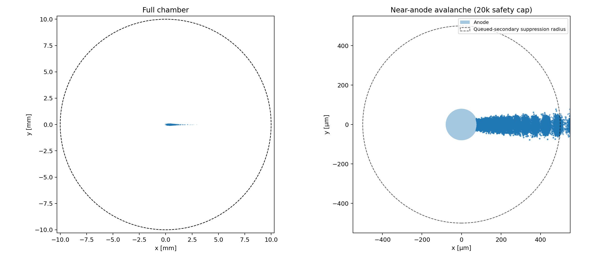
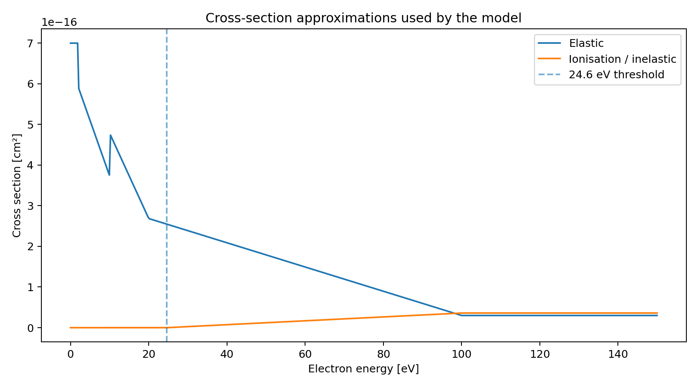

# Monte Carlo Electron Transport in Helium

A scientific computing project simulating electron transport and avalanche formation in helium inside an ideal cylindrical proportional counter. The model combines null-collision Monte Carlo sampling, energy-dependent scattering cross sections and secondary-electron generation, with interchangeable **C99** and **Python/Numba** backends.



[Interactive demo](https://monte-carlo-electron-avalanche-szdcuc7dqeuamvzfh67hbk.streamlit.app/)

## Physical model

A thin anode wire of radius $r_a = 8.0\times10^{-5}\,\mathrm{m}$ sits inside a cylindrical cathode of radius $r_c = 1.0\times10^{-2}\,\mathrm{m}$. For an ideal long coaxial geometry, the electric-field magnitude is

```math
E(r)=\frac{V}{r\ln(r_c/r_a)}.
```

Electrons accelerate inward. Candidate free-flight times are sampled from an exponential distribution at a constant proposal rate. Null proposals extend the free flight; real collisions commit the accumulated displacement and update the acceleration. Elastic events preserve speed and randomise direction within the inward hemisphere. Inelastic events reset the transported electron to thermal energy and create a secondary at the collision site.

Both implementations preserve the same integration and collision-selection rules: elastic proposals use rate-based acceptance, while inelastic proposals are selected by relative cross sections and accepted directly. New electrons starting inside 0.5 mm are recorded without transport; electrons already in flight continue to the physical anode. An electron cap bounds interactive runs and reports truncation.

The model uses simplified analytic cross sections and angular scattering, neglecting end effects, space charge and support structures.

## C99 and Python/Numba implementations

The C99 engine in [`csrc/`](csrc/) implements transport, dynamic electron storage and interaction-point recording using standard C. The original [`simulation.py`](simulation.py) provides the Numba implementation for comparison.

[`simulation_c.py`](simulation_c.py) calls the compiled C library through `ctypes`. It returns the same result interface as Numba, copying interaction positions into a NumPy-owned array before freeing C memory. Both backends drive the same Streamlit controls and four scientific visualisations: near-anode avalanche, full chamber, 3D cloud and cross sections.

## Performance and validation

The original Python implementation achieved a **10× speedup with Numba JIT** over baseline Python. Observed up to 3× faster execution in the deployed Streamlit app.

The C99 implementation achieved a further **1.14–1.31× speedup over Numba** in the following local configurations:

| Configuration | Numba median | C99 median | C speedup |
|---|---:|---:|---:|
| 600 V / 0.6 mm | 5.80 ms | 5.08 ms | 1.14× |
| 1000 V / 3 mm | 2.065 s | 1.581 s | 1.31× |
| 1300 V / 9 mm | 2.102 s | 1.794 s | 1.17× |

Five-seed, warmed-up Windows benchmarks with a 5,000-electron cap; backend order alternated. Timings include NumPy conversion and exclude compilation and plotting. The two higher-voltage configurations reached the cap in every run. [Recorded timings and provenance](tests/results/) retain the individual runs and timing variability.

Run tests and reproduce comparisons from the repository root:

```bash
python -m pytest -q
python -m tests.benchmark_backends
python -m tests.validate_backends --output tests/results/latest/validation_results.json
```

Tests rebuild the C library. New comparison outputs go in `tests/results/latest/`, which is excluded from Git; the recorded evidence is retained separately.

## Installation and execution

Use Python 3.11 or newer. Create and activate a virtual environment:

```bash
python -m venv .venv
```

Windows PowerShell, with MSYS2 UCRT64 GCC installed:

```powershell
.\.venv\Scripts\Activate.ps1
$env:PATH = "C:\msys64\ucrt64\bin;$env:PATH"
```

Linux:

```bash
source .venv/bin/activate
sudo apt-get update
sudo apt-get install -y build-essential
```

Install, build and launch on either platform:

```bash
python -m pip install -r requirements.txt
python build_c.py
python -m streamlit run app.py
```

The build uses C99, `-O3` and compiler warnings, producing `csrc/simulation.dll` on Windows or `csrc/libsimulation.so` on Linux. Set `CC` to a compiler executable path if needed. On Windows, use a Python installation matching the compiler architecture and stop processes using the DLL before rebuilding.

Choose **C99** or **Numba** in the sidebar, adjust voltage, starting radius, seed and electron cap, then click **Run simulation**.

For Streamlit Community Cloud, deploy `app.py` from the repository root. `packages.txt` requests GCC through `build-essential`; the Linux wrapper builds a missing or outdated shared library on first C use. Build failures display an error and leave Numba available. Windows execution is verified; actual Linux/cloud execution remains unverified.

## Python interface

```python
from simulation_c import simulate_avalanche  # import from simulation for Numba

result = simulate_avalanche(
    voltage_v=1000,
    start_radius_m=3e-3,
    seed=42,
    max_electrons=5000,
)
print(result.points.shape)  # float64 (N, 3) array, positions in metres
print(result.electrons_processed, result.secondary_electrons_created)
print(result.truncated)
```

Fixed seeds reproduce results within each backend/runtime. C and Numba use different random generators, and C results can vary across platforms. The wrapper serializes C calls because `srand`/`rand` use global state.

## Cross-section model



The inelastic channel opens at the model's 24.6 eV helium ionisation threshold. The curves show the analytic cross-section approximations used by both implementations.

## Repository structure

```text
csrc/          C99 simulation engine and physics functions
tests/         automated tests, benchmarks and recorded results
figures/       avalanche and cross-section visualisations
app.py         shared Streamlit interface
simulation.py  Python/Numba model
simulation_c.py ctypes interface
build_c.py     Windows/Linux shared-library build
```

## Literature basis

1. **Yousfi, Hennad & Alkaa (1994)**, *Monte Carlo simulation of electron swarms at low reduced electric fields*, Physical Review E 49, 3264–3273. Null-collision electron transport, including helium. [DOI](https://doi.org/10.1103/PhysRevE.49.3264)
2. **Alkaa, Mitev & Ségur (2007)**, *A fast technique for Monte Carlo simulation of the process of gas multiplication in cylindrical proportional counters*, Nuclear Instruments and Methods in Physics Research A 580, 161–164. [DOI](https://doi.org/10.1016/j.nima.2007.05.074)
3. **Kundu & Morton (1999)**, *Numerical simulation of argon–methane gas filled proportional counters*, Nuclear Instruments and Methods in Physics Research A 422, 286–290. Related single-wire avalanche modelling in a different gas mixture. [DOI](https://doi.org/10.1016/S0168-9002(98)00959-0)
4. **Khrabrov & Kaganovich (2012)**, *Electron scattering in helium for Monte Carlo simulations*, Physics of Plasmas 19, 093511. A more detailed electron–helium scattering treatment. [DOI](https://doi.org/10.1063/1.4751865)

## Licence

MIT. See [LICENSE](LICENSE).
